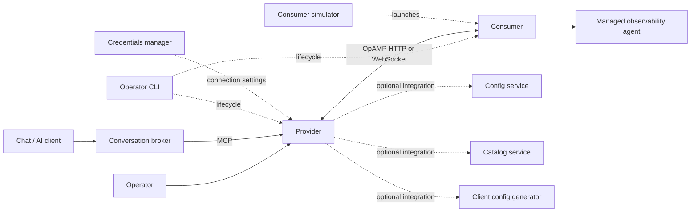

<!--
Copyright 2026 opamp.info
Licensed under the Apache License, Version 2.0 (the "License");
you may not use this file except in compliance with the License.
You may obtain a copy of the License at
http://www.apache.org/licenses/LICENSE-2.0

Unless required by applicable law or agreed to in writing, software
distributed under the License is distributed on an "AS IS" BASIS,
WITHOUT WARRANTIES OR CONDITIONS OF ANY KIND, either express or implied.
See the License for the specific language governing permissions and
limitations under the License.
-->

# Components and Repository Layout

This page is the repository-level map of runtime components, supporting packages,
build entry points, and top-level folders.

## Minimum Runtime

There are two useful definitions of required:

- The `provider` is sufficient to run an OpAMP server and its operator surfaces.
- The `provider` plus at least one `consumer` is required for an end-to-end OpAMP
  exchange with a managed or simulated agent.

Every other runtime component is optional. Optional services can be embedded where
supported or deployed independently, so adopting one feature does not require deploying
the entire repository.

## Component Inventory

| Component | Role | Status in a minimal deployment | Primary documentation |
| --- | --- | --- | --- |
| `provider` | OpAMP server/control plane with HTTP and WebSocket transports, Web UI, API, and optional MCP routes | Required for the server side | [Provider guide](../provider/README.md) |
| `consumer` | OpAMP client framework and built-in plugins for Fluent Bit, Fluentd, Elastic Agent, Elastic Heartbeat, Vector, and simulation | Required for an end-to-end session | [Consumer guide](../consumer/README.md) |
| `config-service` | Configuration editor, validation API, and Python-served browser UI | Optional; standalone or provider-integrated | [Config service guide](../config-service/README.md) |
| `catalog-service` | Configuration discovery/catalog API and browser UI | Optional; standalone or provider-integrated | [Catalog service guide](../catalog-service/README.md) |
| `client-config-generator-service` | Schema-driven consumer configuration generator with load, validation, and safe-save APIs | Optional; enabled by the default provider configuration and standalone-capable | [Generator guide](client_config_generator_service.md) |
| `svr-credentials-mgr` | Authoring, credential-value storage, client assignment, and delivery of OpAMP connection settings | Optional standalone service | [Credentials manager guide](../svr-credentials-mgr/readme.md) |
| `agent_broker` | Collaboration broker for deterministic ChatOps and optional AI-assisted MCP tool planning | Optional separate process | [Conversation broker guide](../agent_broker/README.md) |
| `cli` | Local operator launcher for guided start, stop, restart, status, and demo workflows | Optional convenience tool | [Operator CLI guide](../cli/README.md) |
| `consumer-sim` | Multi-instance simulator launcher for demonstrations, tests, and repeatable validation | Optional; development and test use only | [Simulator guide](../consumer-sim/README.md) |
| `mcp` | Installable MCP client configuration tool and compatibility wrappers | Optional integration tooling | [MCP setup guide](../mcp/README.md) |
| `dev-tools` | Developer CLI for testing, security gates, packaging, SBOMs, releases, generated assets, and maintenance | Development/build tooling | [Developer tools guide](../dev-tools/README.md) |
| `shared` | Common utilities used across runtime packages | Internal library code | [Shared package notes](../shared/README.md) |
| `proto` | OpAMP Protobuf definitions and generated protocol artifacts | Internal build/runtime input | Source folder |

## Runtime Relationships



The provider and consumer are independently deployable. Optional services are outside the
core OpAMP loop and can be introduced only for the workflows that need them.

## Build and Packaging

The main developer entry points are:

```bash
python dev-tools/main.py build artefact all
python dev-tools/main.py build release-assets
python scripts/security_checks.py
```

- `build artefact all` discovers buildable top-level components with a `pyproject.toml`
  and creates source distributions and wheels under `dist/<component>/`. This includes
  the broker, catalog, CLI, client config generator, config service, consumer, simulator,
  MCP tooling, provider, and credentials manager.
- `build release-assets` runs the repository security gate before packaging and, by
  default, builds release wheels and CycloneDX SBOMs for `provider`, `consumer`,
  `catalog-service`, `client-config-generator-service`, `cli`, and `consumer-sim`.
  Its `--components` option can select a subset of those release targets.
- `scripts/security_checks.py` is the compatibility entry point for the full repository
  security gate.
- `svr-credentials-mgr/plaintext-keyring/` is a nested package and is built/tested from
  its own packaging metadata rather than by first-level component discovery.

Generated outputs such as `dist/`, coverage reports, runtime logs, process state, and
server snapshots are local artifacts rather than source components.

For the detailed command matrix and output paths, see the
[developer build, test, and release guide](../dev-tools/docs/build_test_and_release.md).

## Top-Level Folder Summary

| Folder | Purpose |
| --- | --- |
| `.githooks/` | Repository-managed Git hooks. |
| `.github/` | GitHub workflows and repository automation. |
| `agent_broker/` | Optional conversation broker package, collaboration adapters, and operational documentation. |
| `catalog-service/` | Optional configuration catalog service, browser assets, and tests. |
| `cli/` | Optional local operator CLI and its component documentation. |
| `client-config-generator-service/` | Consumer configuration generator service, schema, browser UI, and API. |
| `cloud/` | Provider-neutral and cloud-specific deployment automation and operator guidance. |
| `config/` | Shared default and scenario-specific OpAMP JSON configuration files. |
| `config-service/` | Optional configuration editor/validation service, definitions, schemas, browser assets, and tests. |
| `consumer/` | OpAMP consumer framework, built-in agent plugins, tests, and configuration examples. |
| `consumer-sim/` | Development/test simulator launcher, instance definitions, schemas, and docs. |
| `dev-tools/` | Consolidated developer CLI, test/security/build/release helpers, and retained tool reports. |
| `docs/` | Product, operator, architecture, development, and roadmap documentation. |
| `github-landingpage/` | Source for the repository's published documentation landing page. |
| `mcp/` | MCP client configuration package, defaults, and compatibility wrappers. |
| `proto/` | Protobuf definitions and generated OpAMP protocol artifacts. |
| `provider/` | OpAMP provider/server package, browser console, APIs, and tests. |
| `quick-references/` | Generated or curated agent configuration reference material. |
| `scripts/` | Compatibility wrappers and low-level operational helpers that remain outside `dev-tools`. |
| `security/` | Repository security configuration and supporting policy files. |
| `shared/` | Shared runtime utilities used by provider and consumer code. |
| `svr-credentials-mgr/` | Optional connection-settings credentials manager and nested keyring backend package. |
| `tests/` | Repository-level tests, Playwright prompt template, and container regression scenarios. |

## Related Maps

- [Documentation hub](README.md)
- [Product installation](installation.md)
- [Consumer implementations](consumer_implementations.md)
- [Feature and specification alignment](features.md)
- [Developer documentation](dev/index.md)
