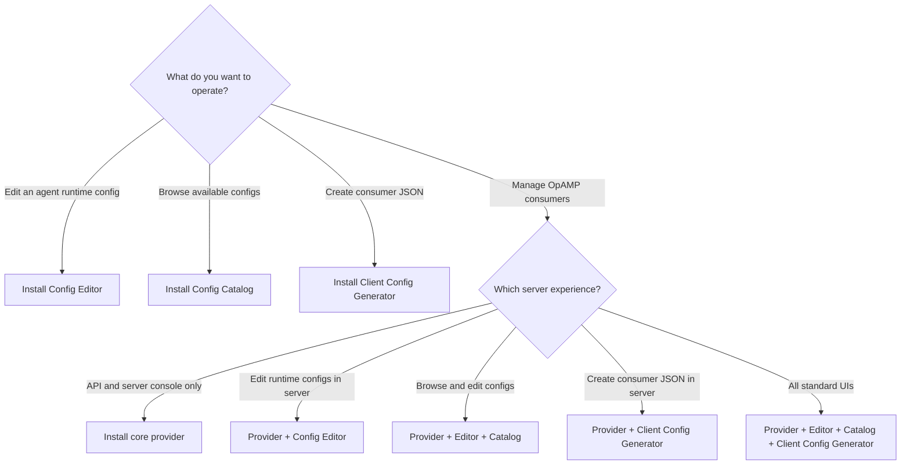
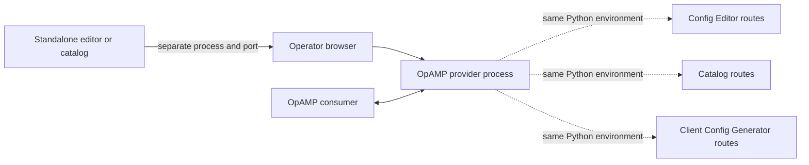

<!--
Copyright 2026 mp3monster.org
Licensed under the Apache License, Version 2.0 (the "License");
you may not use this file except in compliance with the License.
You may obtain a copy of the License at
http://www.apache.org/licenses/LICENSE-2.0

Unless required by applicable law or agreed to in writing, software
distributed under the License is distributed on an "AS IS" BASIS,
WITHOUT WARRANTIES OR CONDITIONS OF ANY KIND, either express or implied.
See the License for the specific language governing permissions and
limitations under the License.
-->

# Product Installation Guide

This page explains how to assemble an OpAMP installation from released Python
wheels. It is organized around the product capability an operator wants to run,
with emphasis on the server side. Source checkouts, editable installs, test
dependencies, and package creation remain in the component and developer guides
linked from [Developer and packaging references](#developer-and-packaging-references).

## Choose an installation

The two similarly named editors serve different purposes:

- **Config Editor** (`config-service`) edits and validates an observability
  agent's runtime configuration, such as Fluent Bit YAML.
- **Client Config Generator** (`client-config-generator-service`) creates the
  OpAMP consumer JSON that tells the supervisor or observer how to connect to
  the provider and manage an agent.



| Product scenario | Wheels to install | Example configuration | Main command |
| --- | --- | --- | --- |
| Config Editor only | `config_service` | [`config-service.json`](../config-service/src/config_service/config/config-service.json) | `config-service` |
| Core provider only | `opamp_server` | Minimal configuration below | `opamp-provider` |
| Provider with Config Editor | `opamp_server`, `config_service` | [`opamp.provider-with-editor-service.json`](../config/opamp.provider-with-editor-service.json) | `opamp-provider` |
| Config Catalog only | `catalog_service` | [`catalog-service.freestanding.example.json`](../catalog-service/config/catalog-service.freestanding.example.json) | `catalog-service` |
| Provider with Config Editor and Catalog | `opamp_server`, `config_service`, `catalog_service` | [`opamp.provider-with-editor-and-catalog-services.json`](../config/opamp.provider-with-editor-and-catalog-services.json) | `opamp-provider` |
| Client Config Generator only | `client_config_generator_service` | [`client-config-generator-service.json`](../client-config-generator-service/src/client_config_generator_service/config/client-config-generator-service.json) | `client-config-generator-service` |
| Provider with Client Config Generator | `opamp_server`, `client_config_generator_service` | [`opamp.provider-with-client-config-generator-service.json`](../config/opamp.provider-with-client-config-generator-service.json) | `opamp-provider` |
| Full standard server UI | `opamp_server`, `config_service`, `catalog_service`, `client_config_generator_service` | [`opamp.json`](../config/opamp.json) | `opamp-provider` |

Install optional embedded components in the **same virtual environment** as
`opamp_server`. The provider loads their configured Python entry points into its
Quart process. A standalone component can instead use its own environment and
port.



## Prerequisites

- Python 3.10 or newer.
- A dedicated virtual environment for each independently managed runtime role.
- The wheel files for one matching product version.
- A deployment-owned JSON configuration file outside the virtual environment.
- Network, TLS, identity-provider, and service-account choices appropriate for
  the target environment.

The examples use `python`; substitute `python3` or `py -3` where required.
Create and activate an environment before installing any scenario:

```bash
python -m venv .venv
source .venv/bin/activate
python -m pip install --upgrade pip
```

PowerShell activation is:

```powershell
python -m venv .venv
.\.venv\Scripts\Activate.ps1
python -m pip install --upgrade pip
```

Wheel filenames normalize project hyphens to underscores. For example, the
`opamp-server` project is distributed as
`opamp_server-<version>-py3-none-any.whl`. Replace `<wheel-directory>` and
`<version>` in the following commands with the downloaded paths and selected
release version.

For provider launches, set `OPAMP_CONFIG_PATH` before invoking the command.
Provider modules read the active configuration during command initialization;
the repeated `--config-path` option then makes the selected path explicit in
the process arguments. In PowerShell, use
`$env:OPAMP_CONFIG_PATH = 'C:\ProgramData\OpAMP\opamp.json'` instead of
`export`.

After each installation, run:

```bash
python -m pip check
```

## Obtain wheel files

### Install released wheels

Download the required wheels from one project release and keep the versions
together. Install from local files so that the selected release is explicit:

```bash
python -m pip install <wheel-directory>/opamp_server-<version>-py3-none-any.whl
```

The release process also produces per-component CycloneDX SBOMs. Retain the
matching SBOM with each deployed wheel according to the organization's software
supply-chain policy.

### Build wheels with repository automation

Building is a developer or release-engineering activity, not a prerequisite on
the production host. From a source checkout, the general artefact automation
can build any packaged component:

```bash
python -m pip install -e ./dev-tools
opamp-dev-cli build artefact named provider
opamp-dev-cli build artefact named config-service
opamp-dev-cli build artefact named catalog-service
opamp-dev-cli build artefact named client-config-generator-service
opamp-dev-cli build artefact named cli
```

The outputs are written below `dist/<component>/`. To build every packaged
component as a wheel and source distribution, use:

```bash
opamp-dev-cli build artefact all
```

The release-assets automation runs the repository security gate, builds its
selected release wheels and SBOMs, and can publish them to a GitHub release:

```bash
opamp-dev-cli build release-assets \
  --components provider,catalog-service,client-config-generator-service,cli
```

`config-service` is not a `release-assets --components` target; build it with
`build artefact named config-service` as shown above. See the
[build, test, and release command reference](../dev-tools/docs/build_test_and_release.md)
for publishing and other release-engineering options.

## Install the Config Editor only

Use this scenario when operators need the agent runtime configuration editor
and validation API without an OpAMP provider.

```bash
python -m pip install <wheel-directory>/config_service-<version>-py3-none-any.whl
python -m pip check
config-service --config-path /etc/opamp/config-service.json
```

Start from the packaged
[`config-service.json`](../config-service/src/config_service/config/config-service.json)
and keep the deployment copy outside the virtual environment. The configured
UI is served at `/config-service/ui` on its configured port. For Windows, use a
deployment-owned path such as `C:\ProgramData\OpAMP\config-service.json`.

The detailed configuration, validation, and developer packaging material is in
the [Config Editor documentation](../config-service/docs/README.md) and
[standalone packaging guide](../config-service/docs/standalone-packaging.md).

## Install the core provider only

Use this scenario for the OpAMP endpoint, server console, APIs, and MCP surface
without optional editor, catalog, or generator routes.

```bash
python -m pip install <wheel-directory>/opamp_server-<version>-py3-none-any.whl
python -m pip check
export OPAMP_CONFIG_PATH=/etc/opamp/opamp.json
opamp-provider --config-path "$OPAMP_CONFIG_PATH" --log-level DEBUG
```

A minimal local configuration is:

```json
{
  "provider": {
    "webui_port": 8080,
    "log_level": "DEBUG",
    "allow-mcp": false,
    "opamp-use-authorization": "none",
    "ui-use-authorization": "none"
  },
  "component-entry-points": {
    "quart": []
  },
  "opamp": {
    "config_catalog": {
      "enabled": false
    }
  }
}
```

The `none` authorization values are suitable only for a protected local
environment. Configure TLS and authentication before exposing the provider to
other networks. See the [provider configuration reference](provider_config_reference.md),
[authentication guide](authentication.md), and
[self-signed TLS guide](self_signed_tls_setup.md).

## Install the provider with the Config Editor

Install both wheels into one environment, copy the example configuration to a
deployment-owned path, and start only the provider process:

```bash
python -m pip install \
  <wheel-directory>/opamp_server-<version>-py3-none-any.whl \
  <wheel-directory>/config_service-<version>-py3-none-any.whl
python -m pip check
export OPAMP_CONFIG_PATH=/etc/opamp/opamp.provider-with-editor-service.json
opamp-provider \
  --config-path "$OPAMP_CONFIG_PATH" \
  --log-level DEBUG
```

Use
[`opamp.provider-with-editor-service.json`](../config/opamp.provider-with-editor-service.json)
as the starting configuration. The provider imports the Config Editor entry
point and serves it at `/config-service/ui`; do not start a second
`config-service` process for this embedded scenario.

## Install the Config Catalog

### Standalone catalog

Use the standalone catalog when configuration browsing must remain independent
of the provider:

```bash
python -m pip install <wheel-directory>/catalog_service-<version>-py3-none-any.whl
python -m pip check
catalog-service --config-path /etc/opamp/catalog-service.json
```

Copy
[`catalog-service.freestanding.example.json`](../catalog-service/config/catalog-service.freestanding.example.json)
and update each catalog source folder for the deployment. Relative source paths
are resolved relative to the configuration file. The UI is served at
`/catalog` on the configured port. If a separately running Config Editor is
advertised in the component entries, catalog rows can open it; otherwise they
use the catalog's read-only viewer.

### Provider with Config Editor and Catalog

Install the three wheels together and start only the provider:

```bash
python -m pip install \
  <wheel-directory>/opamp_server-<version>-py3-none-any.whl \
  <wheel-directory>/config_service-<version>-py3-none-any.whl \
  <wheel-directory>/catalog_service-<version>-py3-none-any.whl
python -m pip check
export OPAMP_CONFIG_PATH=/etc/opamp/opamp.provider-with-editor-and-catalog-services.json
opamp-provider \
  --config-path "$OPAMP_CONFIG_PATH" \
  --log-level DEBUG
```

Start from
[`opamp.provider-with-editor-and-catalog-services.json`](../config/opamp.provider-with-editor-and-catalog-services.json)
and replace its repository-relative catalog source folders with deployment
paths. The provider registers both `/config-service/ui` and `/catalog`.

Catalog behavior and source metadata are described in the
[catalog service README](../catalog-service/README.md) and
[catalog UI guide](opamp_config_catalog_ui.md).

## Install the Client Config Generator

### Standalone agent configuration generator

Use this scenario to create OpAMP consumer JSON without running the provider:

```bash
python -m pip install \
  <wheel-directory>/client_config_generator_service-<version>-py3-none-any.whl
python -m pip check
client-config-generator-service \
  --config-path /etc/opamp/client-config-generator-service.json \
  --host 127.0.0.1 \
  --port 8095
```

Start from the packaged
[`client-config-generator-service.json`](../client-config-generator-service/src/client_config_generator_service/config/client-config-generator-service.json).
The UI is served at `/client-config-generator-service/ui`. Its storage directory
contains generated consumer JSON, so grant write access only to the service
account and operators that should create agent connection configurations.

### Provider with the agent configuration generator

Install both wheels into the provider environment:

```bash
python -m pip install \
  <wheel-directory>/opamp_server-<version>-py3-none-any.whl \
  <wheel-directory>/client_config_generator_service-<version>-py3-none-any.whl
python -m pip check
export OPAMP_CONFIG_PATH=/etc/opamp/opamp.provider-with-client-config-generator-service.json
opamp-provider \
  --config-path "$OPAMP_CONFIG_PATH" \
  --log-level DEBUG
```

Use
[`opamp.provider-with-client-config-generator-service.json`](../config/opamp.provider-with-client-config-generator-service.json)
as the starting configuration. The detailed schema, storage, read-only mode,
and API behavior are in the
[Client Config Generator guide](client_config_generator_service.md).

## Install the full standard server UI

This scenario combines the core provider with all three standard server-side
UI capabilities:

```bash
python -m pip install \
  <wheel-directory>/opamp_server-<version>-py3-none-any.whl \
  <wheel-directory>/config_service-<version>-py3-none-any.whl \
  <wheel-directory>/catalog_service-<version>-py3-none-any.whl \
  <wheel-directory>/client_config_generator_service-<version>-py3-none-any.whl
python -m pip check
export OPAMP_CONFIG_PATH=/etc/opamp/opamp.json
opamp-provider --config-path "$OPAMP_CONFIG_PATH" --log-level DEBUG
```

Start from [`config/opamp.json`](../config/opamp.json), then replace
repository-relative catalog and storage paths with deployment-owned locations.
Only the `opamp-provider` process is required for the embedded UI routes.

## Install command-line tooling

### Operator CLI

The optional `opamp-cli` supplies guided local start, stop, restart, list, and
status workflows. It is separate from every service wheel. Install it in the
environment whose locally installed components it should discover:

```bash
python -m pip install <wheel-directory>/opamp_cli-<version>-py3-none-any.whl
opamp-cli --help
```

The service commands (`opamp-provider`, `config-service`, `catalog-service`,
and `client-config-generator-service`) remain available without `opamp-cli`.
See the [operator CLI guide](../cli/README.md) for the interactive command model
and repository-oriented alias helpers.

### Developer CLI

`opamp-dev-cli` is build and maintenance tooling. Operators do not need it on a
runtime host. Release engineers can install its wheel or install it from a
checkout:

```bash
python -m pip install <wheel-directory>/opamp_dev_tools-<version>-py3-none-any.whl
opamp-dev-cli help
```

Its build, security, SBOM, publishing, documentation, and maintenance commands
are covered in the [developer tooling guide](../dev-tools/README.md).

## Automated environment installation

The repository includes two levels of automation:

| Automation | Intended use | Result |
| --- | --- | --- |
| `scripts/setup_local_venv.*` | Developer workstation | Creates a repository `.venv` and installs editable development dependencies and Node tooling |
| `opamp-dev-cli build artefact ...` | Build/release workstation | Produces component wheels and source distributions below `dist/` |
| `opamp-dev-cli build release-assets ...` | Release workstation | Runs security checks, produces selected wheels and SBOMs, and optionally publishes release assets |
| `cloud/aws/deploy.*` | AWS reference deployment | Packages wheels and provisions the complete two-VM server/consumer environment |
| `cloud/azure/deploy.*` | Azure reference deployment | Packages wheels and provisions the equivalent complete environment |
| `.github/workflows/main_fluent-opamp.yml` | Repository automation | Builds on every configured run and optionally deploys to AWS or Azure |

The cloud deployment is a complete reference topology rather than a
component-minimal installer. Its server role installs the provider, Config
Editor, Client Config Generator, Catalog, CLI, and additional supporting
services into managed environments. Use the
[cloud operator guide](../cloud/operator_guide.md),
[AWS deployment guide](../cloud/aws/readme.md), or
[Azure deployment guide](../cloud/azure/README.md) for prerequisites,
credentials, lifecycle, and retained-artifact behavior.

The shared `cloud/azure/scripts/install-opamp.sh` and role startup scripts are
building blocks used by both cloud implementations. Prefer the provider-level
deploy scripts rather than invoking those internal scripts directly.

## Consumer-side installation

An OpAMP server installation can start without a consumer, but an end-to-end
management path needs at least one consumer beside an observed or supervised
agent. Consumer setup is intentionally kept in the consumer documentation:

- [Consumer configuration and installed commands](../consumer/README.md)
- [Consumer implementation matrix](consumer_implementations.md)
- [Consumer plug-in guides](../consumer/docs/plugins/)
- [Provider and consumer service/daemon setup](service_daemon_setup.md)
- [Client Config Generator](client_config_generator_service.md), which can
  create Supervisor or Observer consumer JSON after its server-side UI is
  installed

The consumer wheel is `opamp_consumer-<version>-py3-none-any.whl`. Keep its
version aligned with the selected server release and install it on the agent
host, not merely in the server environment.

## Post-installation checks

1. Run `python -m pip check` in every runtime environment.
2. Confirm each installed command with `--help` or `--version` where supported.
3. Start the selected service with an explicit configuration path and DEBUG
   logging during installation validation.
4. Open only the routes expected for the selected scenario.
5. Verify file ownership for configuration, generated consumer JSON, catalog
   sources, logs, and provider state snapshots.
6. Configure authentication and TLS before exposing services beyond a protected
   installation network.
7. Register the process with the target service manager by following the
   [service and daemon setup guide](service_daemon_setup.md).

## Upgrade an existing wheel installation

Stop the affected process, back up deployment-owned configuration and state,
then upgrade every wheel in that runtime environment to the same release:

```bash
python -m pip install --upgrade \
  <wheel-directory>/opamp_server-<version>-py3-none-any.whl \
  <wheel-directory>/config_service-<version>-py3-none-any.whl \
  <wheel-directory>/catalog_service-<version>-py3-none-any.whl \
  <wheel-directory>/client_config_generator_service-<version>-py3-none-any.whl
python -m pip check
```

Omit optional component wheels that are not part of the installed scenario.
Restart the service and repeat the post-installation checks. Cloud-managed
environments use the wheel manifest and upgrade automation described in the
[cloud operator guide](../cloud/operator_guide.md).

## Developer and packaging references

These documents deliberately retain source-checkout, editable-install, test,
and packaging detail while this page remains the product-level installation
entry point:

- [Provider README](../provider/README.md)
- [Config Editor standalone packaging](../config-service/docs/standalone-packaging.md)
- [Catalog service README](../catalog-service/README.md)
- [Client Config Generator guide](client_config_generator_service.md)
- [Operator CLI guide](../cli/README.md)
- [Developer CLI guide](../dev-tools/README.md)
- [Build, test, and release commands](../dev-tools/docs/build_test_and_release.md)
